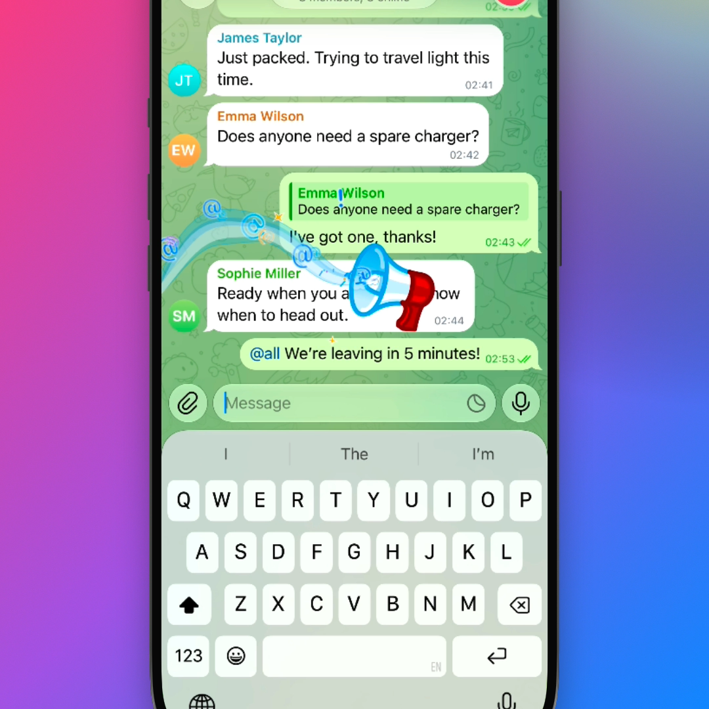

# Mention All Members · @all

Get everyone’s attention with @all. Enable it in group permissions and reach the whole group with a single mention.

[](demo.mp4)

▶︎ **[Watch demo.mp4](demo.mp4)** — group settings → enable Mention All Members → select All members → send.

This is working prototype code in the genuine Telegram iOS client, with a separate offline fixture backend. It is not an enabled Telegram API feature. The video uses fictional travel-chat data; device framing, press rings and camera focus are presentation overlays on captured native UI.

## Behavior

- Mention All Members is off by default, including for administrators. With it off, the suggestion disappears.
- Select All members from the @ menu to insert a semantic collective mention.
- Three calls are allowed in one shared group series, followed by a five-minute break. Five minutes without a call resets a partial series too.
- Silent/scheduled sends, recipient unread mentions and banners, forum topics, edits/forwards and persistent mock state are covered. Failed scheduled calls remain queued for manual retry.
- A new call can play a message-attached megaphone effect. Explicitly chosen effects take priority; Reduce Motion and lifecycle cancellation are supported.

## Code and integration

The complete source changes are in this fork/PR, not a standalone screen mockup. The PR’s `.patch` URL also provides the complete diff.

| Area | Repository path |
| --- | --- |
| Semantic atom, UTF-16 validation and formatting | `submodules/TextFormat/` and `submodules/TelegramCore/Sources/ChatInputContent/` |
| Suggestion and permission UI | `AllMembersMentionChatInputPanelItem.swift`, `MentionChatInputContextPanelNode.swift`, `ChannelPermissionsController.swift` |
| Permission, shared quota, queue and recipient state | `submodules/TelegramUIPreferences/Sources/AllMention*.swift` |
| Effect and exact-message attachment | `AllMentionSendEffectNode.swift`, `ChatControllerNode.swift` |
| Offline account, topics, delivery and fixture storage | `submodules/TelegramUI/Sources/AllMentionDemo*.swift` |

[Detailed behavior and architecture](../all-mentions.md) · [Required server integration](../all-mentions-server.md)

No TL schema or API constructor is invented. Real cloud groups remain gated until Telegram supplies the capability, permission, entity, server quota/scheduler and synchronized notification/read state.

## Build and run the offline demo

The current upstream base is `279f89e4` (Telegram 13.1.2) and requires **Xcode 27.1** and macOS per the repository’s `versions.json`. Clone this fork recursively and select the PR branch. From the checkout root:

```sh
python3 docs/proposals/all-mentions/tools/build-demo.py --repo "$PWD" --execute --build-number 100044
unzip -qo bazel-bin/Telegram/Telegram.ipa -d build-input/.local-allmention/review-app
xcrun simctl install booted build-input/.local-allmention/review-app/Payload/Telegram.app
xcrun simctl launch booted org.allmention.TelegramClient --all-mention-demo --all-mention-demo-showcase --all-mention-demo-sender --all-mention-demo-regular
```

The helper fixes API placeholders to `api_id=0`/empty hash and uses a separate Debug bundle. It does not read real keys, sign in or open an existing real account. Existing mock stores are retained. The showcase starts with eight fictional friends in Weekend Trip and permission off.

For the recipient, use `--all-mention-demo-showcase --all-mention-demo-recipient`; an explicit `--all-mention-demo-incoming` injects a mock call subject to permission and quota. For topics add `--all-mention-demo-showcase --all-mention-demo-forum --all-mention-demo-topic 100`. The legacy QA dataset is selected explicitly with `--all-mention-demo-qa`.

After building, run the four focused XCTest targets on an available simulator:

```sh
python3 docs/proposals/all-mentions/tools/run-tests.py --repo "$PWD" --device SIMULATOR_UDID
```

## Validation and limits

**97/97 native tests passed** across 11 classes and 4 targets on the tested `5c20d095` base, build 100044, Xcode 27.0. The full app build and native simulator demonstration passed on that base. [Per-method results](validation/results.json) · [Validation scope](validation/RESULTS.md).

The current-master port was clean-apply checked and syntax-checked, but **has not had a full app build or Swift type-check with Xcode 27.1**. It resolves four upstream conflicts, including avoiding occupied preference IDs24/25 by using26. The old local SDK workaround is excluded. Server delivery, actual APNs, multi-device state and physical-device performance are not established by the offline demo.

## Assets

The effect’s Bell and Grip TGS assets derive from the repository’s BroadcastGroup animation. The legacy QA photograph retains its attribution and CC BY-SA 4.0 license in `AllMentionDemoCredits.txt`; the default travel showcase does not display it. Existing repository licenses continue to apply.
